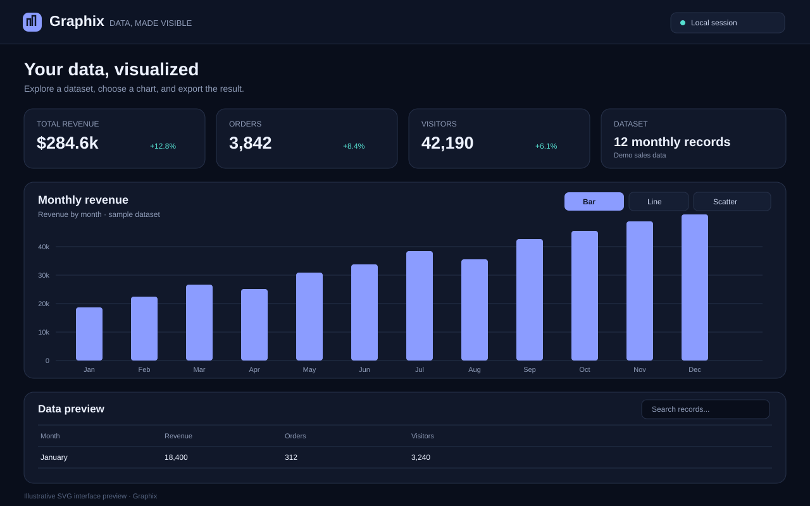
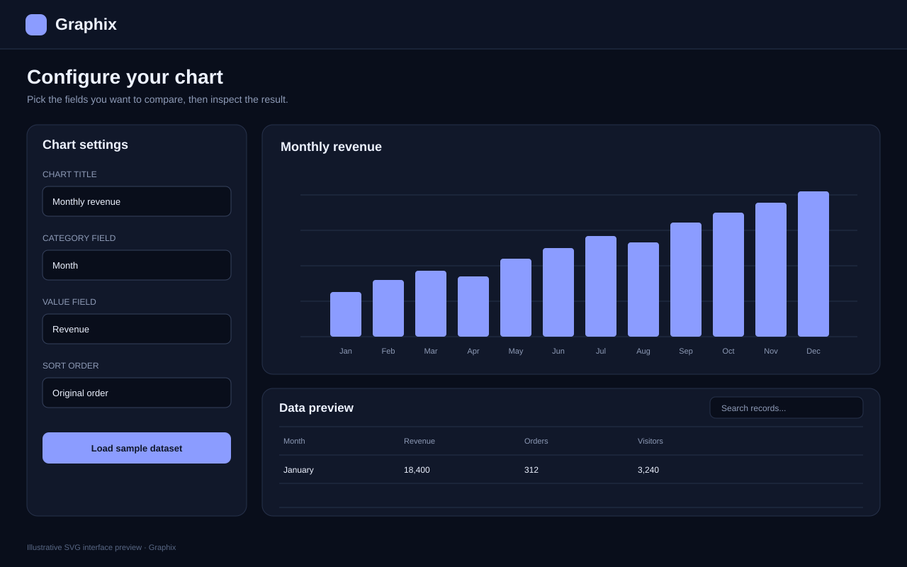
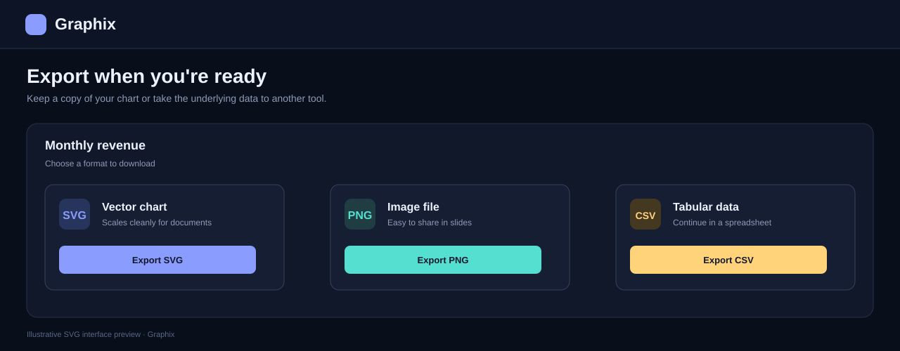

# Graphix

Graphix is a browser-based workspace for turning tabular data into charts you can inspect and export. It runs as a static site, so you can open it locally or publish it with GitHub Pages.

*Dashboard preview: sample monthly metrics, chart controls, and a data table. This is a repository-made SVG preview of the interface, not a browser-captured screenshot.*

## What you can do

- Start with the built-in monthly sales sample or import a CSV or JSON file.
- Build bar, line, or scatter-style charts.
- Choose the category and value fields, edit the chart title, and sort the values.
- Search the table preview to find records.
- Download charts as SVG or PNG, or export the dataset as CSV.
- Use the layout on desktop and smaller screens, with keyboard focus indicators and reduced-motion support.

## Try it locally

1. Download or clone this repository.
2. Open `index.html` in a modern browser.

No package installation, build command, account, or backend is required. You can also serve the folder with any static file server.

## Importing data

Use a CSV file with a header row or a JSON file containing an array of objects. Each object should use consistent field names. For the clearest charts, choose a category field for the horizontal labels and a numeric field for the values.

Graphix processes imported files in the browser. The current implementation does not send file contents to a server. Files are limited to 15 MB and 100,000 rows. The chart displays up to 250 records, and the table preview displays up to 500 rows.

## Exporting your work

Use the export controls to save the current chart as SVG or PNG. Export the loaded dataset as CSV when you need to continue working in a spreadsheet or another analysis tool.

## Publish with GitHub Pages

1. Open the repository's **Settings** page.
2. Select **Pages**.
3. Choose **Deploy from a branch** as the source.
4. Select the branch you want to publish and the `/(root)` folder.
5. Save the settings and wait for GitHub Pages to finish publishing.

The site entry point is `index.html`. The included `.nojekyll` file prevents GitHub Pages from applying Jekyll processing to the repository.

## Current limitations

- CSV parsing handles common comma-separated files with quoted fields. It does not cover every delimiter or spreadsheet dialect.
- Numeric parsing uses JavaScript number conversion. Normalize locale-specific decimal formats before import.
- The scatter-style view plots a selected value against record order. It is not yet a true XY scatter plot using two numeric columns.
- The current app has no saved workspaces, multi-series chart builder, or server-side analysis.
- The documented test checklist is manual. Browser interaction and assistive-technology tests should be run before a production release.

See [the manual test checklist](docs/TESTING.md) for the checks to complete before publishing.
